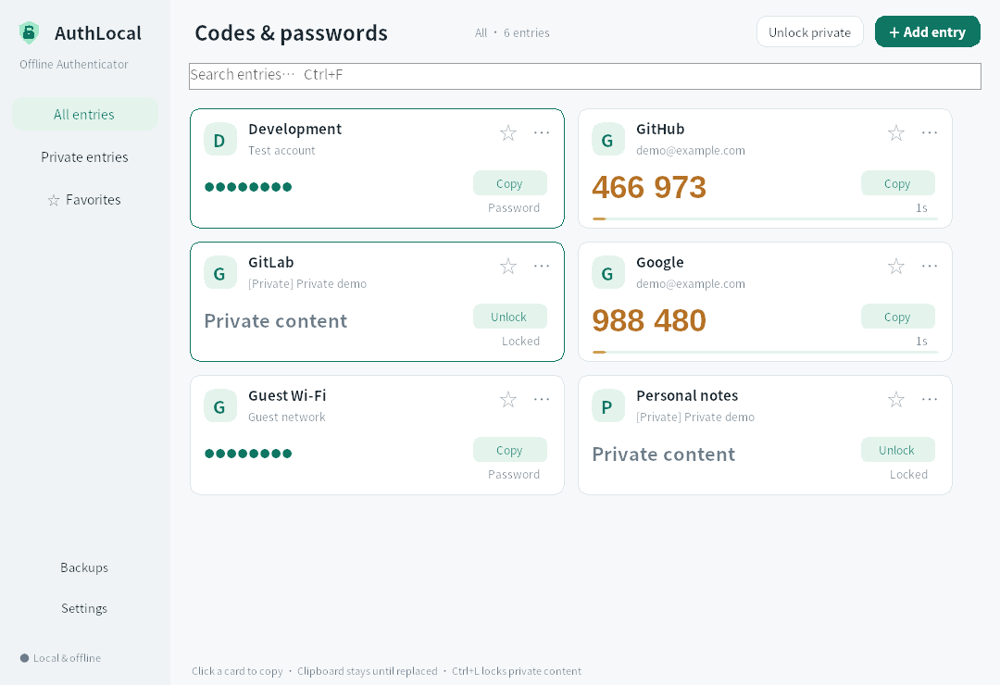
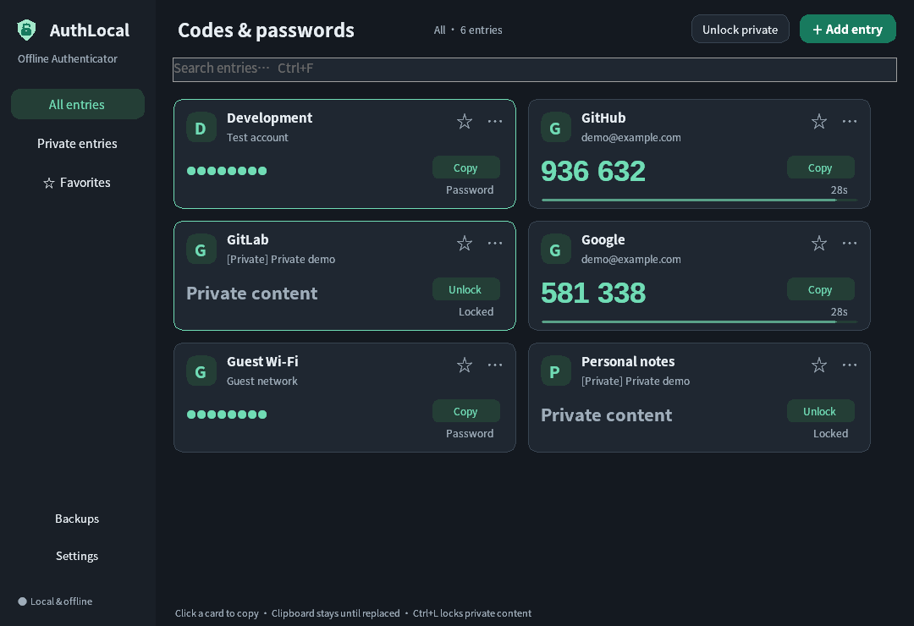

# AuthLocal for Windows

[](https://github.com/tobeQAQ/AuthLocal/actions/workflows/windows.yml)
[](LICENSE)

English · [简体中文](README.md)

An offline Windows authenticator with saved-password shortcuts. All entries appear
on the home screen; click a card to copy. Only entries you mark private require a
master password. This independent project is not affiliated with 2FAS.

**Do not store important passwords here.** The first launch requires acknowledgement
of this warning. Use test or low-risk accounts and keep independent recovery methods.




## Install

Supports Windows 10 1809 / Windows 11 x64. Packages include the .NET runtime.
Obtain releases from [Releases](https://github.com/tobeQAQ/AuthLocal/releases), or
packages from successful [Windows Actions runs](https://github.com/tobeQAQ/AuthLocal/actions/workflows/windows.yml).

- `AuthLocal-1.5.0-windows-x64-setup.exe`: per-user install, Start menu shortcut and standard uninstall registration.
- `AuthLocal-1.5.0-windows-x64-portable.zip`: extract and run `AuthLocal.exe`.
- `AuthLocal-1.5.0-windows-x64-SHA256SUMS.txt`: download checksums.

The portable package still keeps data in the current Windows user's application
data directory. Binaries are currently unsigned.

## Use

Add a TOTP entry with a manual secret, `otpauth://` URI or QR image, or add a saved
password. Click its card to copy. Passwords are masked by default. Letters,
symbols, Unicode and leading/trailing spaces are preserved.

**Copied text is never automatically erased.** Switching windows, minimizing,
locking, hiding to tray, waiting and exiting leave it available to paste. A later
copy replaces it normally.

Mark selected entries private to require a master password. Five characters,
including five digits, are accepted. Private names remain visible on the home
screen; their contents require unlocking. Private content locks on timeout,
minimize, close-to-tray, Windows session lock or sleep.

Closing the window keeps the app running in the system tray. Click the tray icon
to reopen the home screen; right-click it to exit completely. The default private
idle timeout is five minutes, adjustable to one or fifteen minutes.

Settings include System / Light / Dark appearance, with System as the default,
and Simplified Chinese, Traditional Chinese, English, French and Japanese. Language
follows Windows by default; unsupported languages fall back to English.

Ctrl+F searches, Ctrl+N adds a TOTP entry, and Ctrl+L locks private content.
The compact layout takes navigation and list placement inspiration from the
[Clash Verge preview](https://github.com/clash-verge-rev/clash-verge-rev#preview),
with its own implementation and colors.

## Upgrade and data

Exit the old app from its tray menu before installing an update. A fixed Inno
Setup AppId preserves the installation path and updates one Windows uninstall
entry. Setup blocks replacement while the app is running. There is no online
automatic updater.

The installer defaults to `%LOCALAPPDATA%\Programs\AuthLocal` without elevation.
Only installation path/version and standard uninstall metadata are registered
under HKCU. No account credentials go into the registry. Uninstall retains data
and preferences.

For compatibility with earlier LocalAuth releases, data remains at
`%LOCALAPPDATA%\LocalAuth`:

| File | Purpose |
| --- | --- |
| `ordinary.local` | Ordinary entries, protected by current-user Windows DPAPI and opened automatically |
| `accounts.vault` | Private entries encrypted with the master password |
| `private-index.local` | Home screen names, types, IDs and favorite flags, without secrets |
| `accounts.vault.bak` | Previous encrypted private-vault save |
| `settings.json` | Appearance, language, timeout and warning acknowledgement |
| `app.lock` | Single-instance write lock |

Use the Backup and restore menu to export **both** ordinary and private entries.
Ordinary exports receive a backup password; private exports use the current master
password. Directly copying `ordinary.local` is not a cross-user or OS-reinstall
backup. The master password cannot be recovered. Changing it does not re-encrypt
previously exported files.

Old private vaults keep their protection. Unlock once to populate the home screen
name index, then optionally move individual entries to ordinary storage.

## Scope

TOTP supports SHA1/SHA256/SHA512, six/eight digits and periods of 5–300 seconds.
QR import reads single-account PNG/JPG/BMP/GIF images offline. Entries support
search, favorites, editing and protection changes. The application makes no
network requests and has no telemetry or cloud sync.

Private storage uses PBKDF2-HMAC-SHA256 with 600,000 iterations and AES-256-GCM.
A five-digit password favors convenience and is unsuitable for important secrets.
Clipboard history is outside the app's control. See [SECURITY.md](SECURITY.md).

HOTP, live camera scanning, `.2fas` backup import and Google Authenticator migration
QRs are not supported. Codes depend on the computer's clock.

## Build and test

Use Windows, .NET 10 SDK, PowerShell 7 and Python 3 for translation checks.

```powershell
dotnet run --project tests/LocalAuth.Tests -c Release
dotnet run --project tests/LocalAuth.Windows.Tests -c Release -r win-x64
python scripts/check-localization.py
./build.ps1 -Installer
```

The script runs both test suites by default and produces packages in
`artifacts/packages`. Installer builds use the official SHA256-verified Inno Setup
7.1.1 compiler. CI additionally exercises install, blocked running-app replacement,
upgrade registration and uninstall while checking data preservation.

See [test coverage/results](docs/TESTING.md), [contributing](CONTRIBUTING.md) and
[changelog](CHANGELOG.md). Internal LocalAuth namespaces and storage paths remain
for compatibility.

## License

[MIT](LICENSE). Runtime, QR library and installer engine notices are listed in
[THIRD-PARTY-NOTICES.txt](THIRD-PARTY-NOTICES.txt) and `licenses/`.
