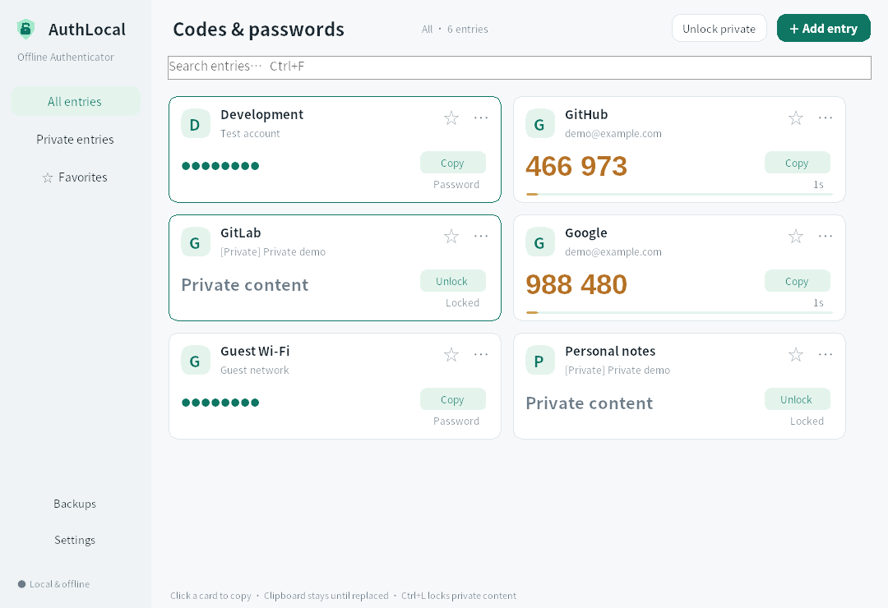
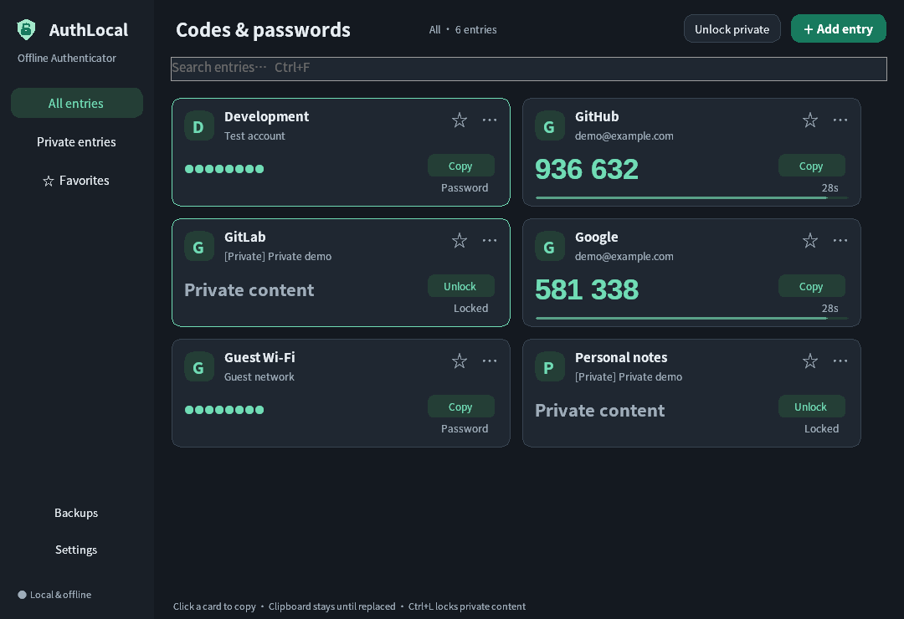
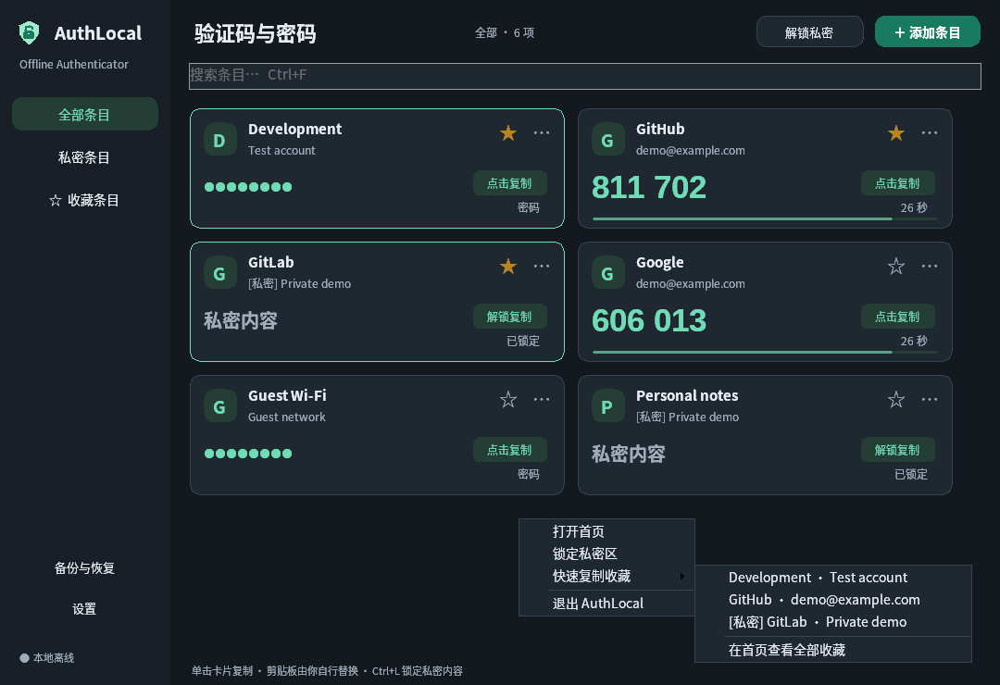

# AuthLocal for Windows

[](https://github.com/tobeQAQ/AuthLocal/actions/workflows/windows.yml)
[](LICENSE)

[English](README.en.md) · 简体中文

离线 Windows 验证码与密码快捷复制工具。打开即看到全部条目，单击卡片复制；只有自行标记为私密的内容需要主密码。提供类似手机 2FAS 的基础 TOTP 功能，本项目与 2FAS 官方无关。

**请勿在此保存重要密码。** 首次打开会显示提醒，需要勾选确认后才能继续。适合个人测试和低风险账户，请自行保留备份与找回方式。




## 下载与安装

当前支持 Windows 10 1809 / Windows 11 的 x64 电脑。发布包自带 .NET，不需要另装运行时。

从 [Releases](https://github.com/tobeQAQ/AuthLocal/releases) 获取正式发布；[Actions](https://github.com/tobeQAQ/AuthLocal/actions/workflows/windows.yml) 中通过检查的构建也会附带软件包。

| 文件 | 用法 |
| --- | --- |
| `AuthLocal-1.6.0-windows-x64-setup.exe` | 推荐。为当前用户安装，创建开始菜单入口并登记卸载信息 |
| `AuthLocal-1.6.0-windows-x64-portable.zip` | 解压后运行 `AuthLocal.exe`，不登记安装信息 |
| `AuthLocal-1.6.0-windows-x64-SHA256SUMS.txt` | 校验下载文件 |

压缩包版的“portable”指程序免安装，数据仍保存在当前 Windows 用户目录。发布包尚无代码签名证书。

## 日常使用

1. 默认直接进入首页，2FA 与保存的密码一起显示，无需登录。
2. 「添加条目」可选择 TOTP 或保存密码。支持手动密钥、`otpauth://` 链接和二维码图片。
3. 单击卡片或「复制」即可复制。保存的密码默认以圆点显示，编辑时可以查看原文。
4. 需要时勾选「设为私密」。第一次使用私密区才设置主密码，最低 5 个字符，允许纯数字。首页仍列出私密卡片名称，内容需解锁后查看或复制。
5. 「设置」可选跟随系统 / 浅色 / 深色。默认跟随系统，系统主题变化时自动切换，也可手动指定并保存。
6. 界面支持简体中文、繁体中文、English、Français、日本語，默认跟随系统；不支持的系统语言回退到英文。

**复制内容不会自动清空。** 切换窗口、最小化、锁定、收起到托盘、等待和退出均不会删除已复制的内容；之后的复制操作会照常替换剪贴板。

右键托盘图标可进入「快速复制收藏」：普通收藏直接复制，私密收藏会先打开窗口并要求解锁。菜单展示前 12 个收藏，也可点击「在首页查看全部收藏」。托盘提示会短暂显示「已复制」，菜单不会显示密码或验证码。



再次双击 `AuthLocal.exe` 会唤回已有窗口，保留正在编辑的对话框。窗口隐藏或最小化时停止卡片刷新，重新显示时立即更新验证码。

关闭窗口会收起到 Windows 右下角托盘并继续运行。单击托盘图标打开首页；右键可锁定私密区或彻底退出。最小化、收起、系统锁屏、睡眠、闲置超时只锁定私密内容。闲置锁定默认 5 分钟，可改为 1 / 15 分钟。

| 快捷键 | 操作 |
| --- | --- |
| Ctrl+F | 搜索 |
| Ctrl+N | 添加验证码 |
| Ctrl+L | 锁定私密内容 |

首页采用紧凑侧栏与工具栏，卡片直接排列在搜索框下方。布局参考 [Clash Verge 的项目预览](https://github.com/clash-verge-rev/clash-verge-rev#preview)，使用本项目自己的实现与配色。

## 升级与注册表

先退出托盘中的旧版，再运行新版安装包。固定的安装标识让覆盖升级沿用原安装路径，并更新 Windows「已安装的应用」中的版本与卸载入口。安装程序会阻止在应用运行时替换文件。

默认安装到 `%LOCALAPPDATA%\Programs\AuthLocal`，无需管理员权限。注册表仅写入当前用户的安装信息：

- `HKCU\Software\AuthLocal`：安装路径与版本。
- `HKCU\Software\Microsoft\Windows\CurrentVersion\Uninstall\{8CEEC88B-634A-4BAE-A5C2-104385962A36}_is1`：标准卸载入口。

注册表不保存账户密钥、密码或主密码。登记安装信息用于覆盖升级和卸载，**当前没有联网自动更新**。卸载仅删除程序和安装登记，保留账户与设置。

旧版 LocalAuth 的数据位置和加密格式保持兼容。旧版全私密账户库需用原主密码「解锁并同步」一次，随后首页会列出私密名称；可以通过条目菜单「移到普通区」设为日常直接使用。升级前请先导出备份。

## 备份与本机数据

「备份与恢复」分别导出普通条目和私密条目。需要完整备份时请各导出一次。普通条目导出时为备份设置密码；私密备份沿用当前主密码。导入时明确选择目标分区。主密码无法找回。

数据继续使用 `%LOCALAPPDATA%\LocalAuth\`，避免产品改名造成旧数据丢失：

| 文件 | 内容 |
| --- | --- |
| `ordinary.local` | 普通条目，Windows 当前用户 DPAPI 加密，打开即用 |
| `accounts.vault` | 私密条目，主密码加密 |
| `private-index.local` | 私密名称、ID、类型及收藏状态索引，不含密码或 OTP 密钥 |
| `accounts.vault.bak` | 私密区上一次保存的加密备份 |
| `settings.json` | 主题、语言、锁定时长及首次提醒确认状态 |
| `app.lock` | 单实例写入锁 |
| `before-restore-*.vault` | 恢复前保留的加密副本 |

普通条目与当前 Windows 用户绑定，跨用户或重装系统时应使用软件导出的加密备份。请勿依靠直接复制 `ordinary.local` 恢复。修改主密码不会修改此前导出的备份密码。

## 功能与边界

- TOTP：SHA1 / SHA256 / SHA512，6 / 8 位，5–300 秒周期，默认 6 位 / 30 秒。
- 离线读取 PNG / JPG / BMP / GIF 中的单账户 TOTP 二维码。
- 添加、编辑、删除、搜索、收藏，以及普通 / 私密保护切换。
- 原子保存；保护切换先保存目标再移除来源，失败尝试回滚。
- 私密区使用 PBKDF2-HMAC-SHA256（600,000 次迭代）和 AES-256-GCM。
- 应用无联网请求、遥测或云同步。

普通区依赖当前 Windows 用户身份；私密名称会显示在首页。5 位数字主密码是便捷性选项，不适合重要凭据。锁定不会清除系统剪贴板或其历史。详见 [SECURITY.md](SECURITY.md)。

不支持 HOTP、摄像头实时扫描、`.2fas` 备份导入和 Google Authenticator 批量迁移二维码。验证码依赖电脑系统时间，异常时请在 Windows 设置中同步时间。

## 开发与验证

需要 Windows、.NET 10 SDK 和 PowerShell 7；翻译检查使用 Python 3。

```powershell
dotnet run --project tests/LocalAuth.Tests -c Release
dotnet run --project tests/LocalAuth.Windows.Tests -c Release -r win-x64
python scripts/check-localization.py
./build.ps1 -Installer
```

构建脚本默认先运行核心与 Windows 检查，再生成安装版和免安装包。编译安装包使用校验 SHA256 的官方 Inno Setup 7.1.1。输出位于 `artifacts/packages`。

[测试说明与结果](docs/TESTING.md) · [贡献指南](CONTRIBUTING.md) · [更新记录](CHANGELOG.md)

`src/LocalAuth.Core` 为算法与存储，`src/LocalAuth.App` 为 WinForms 界面和 Windows 集成，`tests` 为回归检查。内部命名保留 LocalAuth，以兼容旧数据。

## 许可

本项目采用 [MIT](LICENSE)。.NET、ZXing.Net 与安装引擎许可见 [THIRD-PARTY-NOTICES.txt](THIRD-PARTY-NOTICES.txt) 和 `licenses/`。
